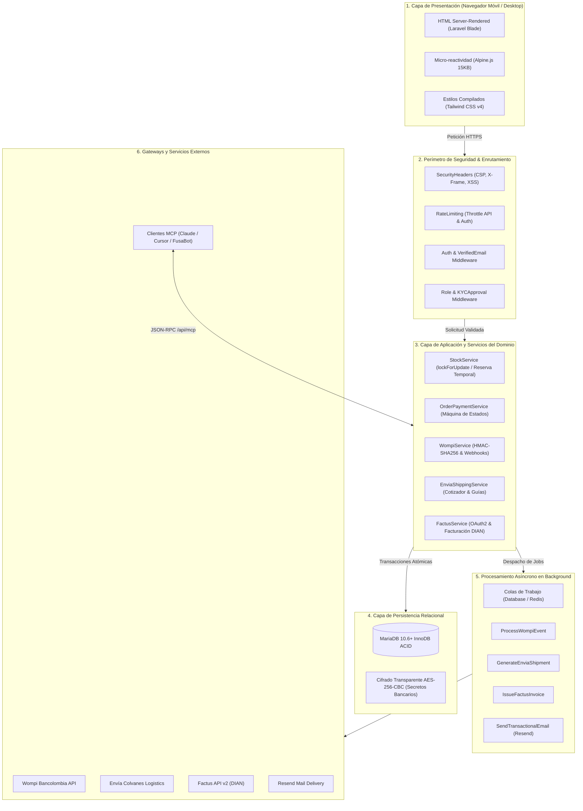

## 1. Visión General del Ecosistema

**FusaShop** es una plataforma de comercio electrónico territorial y omnicanal concebida para digitalizar la economía formal y productiva de **Fusagasugá y la Provincia del Sumapaz** (Cundinamarca, Colombia).

A diferencia de los marketplaces tradicionales diseñados para conexiones metropolitanas de ultra-alta velocidad, FusaShop implementa una arquitectura deliberadamente optimizada para operar con **alta resiliencia, bajo consumo de ancho de banda y rendimiento instantáneo en dispositivos móviles de gama media**.

<CardGroup cols={3}>
  <Card title="Laravel 12.x + PHP 8.3" icon="server" color="#FF2D20">
    Backend server-rendered con tipado estricto, pipeline de eventos, colas asíncronas y Eloquent ORM.
  </Card>
  <Card title="Alpine.js 3.x + Tailwind v4" icon="bolt" color="#006C47">
    Reactividad declarativa en 15 KB gzipped, compilación CSS Oxygen instantánea y cero sobrecarga de hidratación.
  </Card>
  <Card title="MariaDB InnoDB ACID" icon="database" color="#003545">
    Bloqueos pesimistas (`lockForUpdate`), aislamiento transaccional y protección contra sobreventa concurrente.
  </Card>
</CardGroup>

---

## 2. Matriz del Stack Tecnológico

| Componente | Tecnología | Versión | Rol en el Sistema | Justificación Técnica de Selección |
|---|---|---|---|---|
| **Backend Framework** | Laravel | 12.x | Núcleo del Sistema | Arquitectura MVC/Service Layer madura, pipeline de middlewares, inyección de dependencias y suite de testing nativa. |
| **Lenguaje / Runtime** | PHP | 8.2+ / 8.3 | Motor de Ejecución | JIT compiler de alto rendimiento, tipos de unión, propiedades `readonly`, enums respaldados y gestión eficiente de memoria. |
| **Base de Datos** | MariaDB / MySQL | 10.6+ / 8.0 | Persistencia Relacional | Motor transaccional InnoDB con soporte ACID pleno, integridad referencial foránea e índices compuestos para catálogo. |
| **Frontend Reactivo** | Alpine.js | 3.x | Interactividad Cliente | Reactividad granular directa en el DOM sin bundle virtual pesado ni ciclo de compilación Node en el navegador. |
| **Framework de Estilos** | Tailwind CSS | v4.0 | Sistema de Diseño | Motor Oxygen sin archivo `tailwind.config.js` pesado; genera CSS crítico mínimo directamente en el pipeline de Vite. |
| **Colas de Tareas** | Database / Redis | Driver Nativo | Procesamiento Asíncrono | Desacopla tareas externas (webhooks Wompi, guías Envía, facturas DIAN y correos) garantizando respuestas HTTP < 200 ms. |
| **Capa de Caché** | File / Redis | Cache Facade | Aceleración de Lecturas | Cacheo de tokens de autenticación OAuth2 (Factus 50 min), consultas de catálogo y directivas de sesión. |
| **Pasarela de Pagos** | Wompi Bancolombia | API v1 + Webhooks | Cobro Multitienda | Cobertura local con PSE, tarjetas débito/crédito, Nequi y Botón Bancolombia, con firma de integridad SHA-256. |
| **Operador Logístico** | Envía Colvanes | API REST | Logística y Despachos | Cotización dinámica en tiempo real por peso/volumen, generación de guías PDF y trazabilidad nacional unificada. |
| **Facturación DIAN** | Factus API | v2 (Colombia) | Cumplimiento Fiscal | Generación y validación automática de factura electrónica de venta con CUFE, código QR y almacenamiento XML/PDF. |
| **Protocolo de IA** | Model Context Protocol | JSON-RPC | Servidor de Contexto | Endpoint protegido (`/api/mcp`) para que asistentes de IA consulten inventario, comercios y pedidos de forma segura. |

---

## 3. Registro de Decisiones de Arquitectura (ADR)

### ADR-001: Arquitectura Server-Side Rendered (SSR) con Blade + Alpine en lugar de SPA (React / Vue)

<AccordionGroup>
  <Accordion title="Contexto y Problemática Regional" defaultOpen={true}>
    En la provincia del Sumapaz, más del **70% de las transacciones de comercio electrónico se originan desde dispositivos móviles** con procesadores modestos conectados a redes celulares 3G o 4G con latencia fluctuante (80 ms – 300 ms). 
    
    Una arquitectura SPA (Single Page Application) tradicional requiere descargar bundles JavaScript pesados (1.5 MB – 3.0 MB), parsear el código en CPU móvil lenta, ejecutar hydration y luego realizar múltiples peticiones fetch sucesivas a endpoints REST para renderizar la tienda.
  </Accordion>

  <Accordion title="Decisión de Ingeniería">
    Se optó por una arquitectura **Server-Side Rendered (SSR)** híbrida basada en **Laravel Blade** para la estructura HTML semántica pre-renderizada en servidor, combinada con **Alpine.js (15 KB)** para la micro-interactividad reactiva en cliente (filtros en vivo, carritos desplegables, modales y toggles).
  </Accordion>

  <Accordion title="Evaluación Comparativa de Rendimiento">
    | Métrica de Rendimiento | SPA Tradicional (React/Vue + Vite) | FusaShop (Blade SSR + Alpine.js) | Beneficio Observado |
    |---|---|---|---|
    | **Peso del Bundle JS Inicial** | ~1,850 KB | **~15 KB** (Alpine) + CSS | **Reducción del 99%** de transferencia |
    | **First Contentful Paint (FCP)** | 1.8 s – 3.2 s (red móvil) | **< 380 ms** | Pantalla útil instantánea |
    | **Time to Interactive (TTI)** | 3.5 s – 5.0 s (re-hidratación) | **< 450 ms** | Botones e inputs listos de inmediato |
    | **Uso de Memoria RAM en Cliente** | 120 MB – 250 MB | **< 28 MB** | No congela navegadores móviles |
    | **Indexación SEO y OpenGraph** | Requiere SSR extra (Next.js/Nuxt) | **Nativo en cada vista** | Vistas previas perfectas en WhatsApp |
  </Accordion>

  <Accordion title="Consecuencias y Trade-offs">
    - **Positivas:** Reducción drástica del abandono por lentitud de carga, soporte nativo de navegación hacia atrás/adelante en navegador, simplificación de la base de código (un solo lenguaje de backend y templates) y compatibilidad total con SEO.
    - **Mitigadas:** Las transiciones de página completas se optimizan mediante prefetch selectivo y diseño visual optimista con Alpine.js.
  </Accordion>
</AccordionGroup>

---

## 4. Diagrama de la Arquitectura Multicapa

El siguiente diagrama detalla cómo interactúan las seis capas principales de FusaShop, desde la solicitud HTTP del usuario hasta la dispersión bancaria y la facturación fiscal ante la DIAN:



---

## 5. Ciclo de Vida de una Petición de Compra

Para comprender la orquestación en tiempo de ejecución, a continuación se desglosan los pasos ejecutados durante una compra exitosa:

<Steps>
  <Step title="1. Selección en Carrito y Cotización de Envío">
    El comprador selecciona ítems físicos en su carrito. La aplicación consulta el servicio `EnviaShippingService` enviando peso consolidado y código DANE de destino para obtener la tarifa vigente.
  </Step>

  <Step title="2. Creación Atómica de la Orden y Reserva de Stock">
    Al confirmar el checkout, `StockService` bloquea las filas de productos mediante `SELECT ... FOR UPDATE` dentro de una transacción `DB::transaction`. Se verifica disponibilidad y se crea un registro de orden en estado `pending`, deduciendo temporalmente las existencias para prevenir sobreventa concurrente.
  </Step>

  <Step title="3. Pago Seguro en Wompi con Firma de Integridad">
    El sistema genera una firma de integridad SHA-256 combinando:
    ```text
    SHA256(referencia + monto_en_centavos + "COP" + integrity_secret)
    ```
    El comprador completa el pago en el widget seguro de Wompi (tarjeta, PSE, Nequi o Bancolombia).
  </Step>

  <Step title="4. Recepción de Webhook e Idempotencia">
    Wompi notifica al endpoint `/api/webhooks/wompi`. El controlador verifica la firma criptográfica del evento y despacha el job `ProcessWompiEvent` a la cola, respondiendo inmediatamente con código HTTP `200 OK`.
  </Step>

  <Step title="5. Confirmación de Pago y Despacho de Procesos Posteriores">
    Al ejecutarse el job, `OrderPaymentService` pasa la orden al estado `paid`. Inmediatamente se despachan a la cola de forma desacoplada:
    - `GenerateEnviaShipment`: Genera la guía de transporte con número de tracking y etiqueta PDF.
    - `IssueFactusInvoice`: Transmite la factura electrónica a Factus v2 para validación ante la DIAN, obteniendo CUFE y código QR.
    - Notificaciones transaccionales por correo y mensajes al comprador y comerciante.
  </Step>
</Steps>

---

## 6. Principios de Seguridad y Aislamiento

<Tabs>
  <Tab title="Cifrado Criptográfico Transparente">
    Las credenciales bancarias y secretos de pasarela configurados por los comerciantes (`wompi_private_key`, `integrity_secret`, llaves de API) nunca se almacenan en texto plano en la base de datos.
    
    Se utiliza el cast de Eloquent `EncryptedGatewaySecret` que aplica automáticamente el algoritmo **AES-256-CBC con autenticación HMAC**, derivado de la clave maestra `APP_KEY` del archivo `.env`.
  </Tab>

  <Tab title="Hardening de Cabeceras HTTP">
    El middleware `SecurityHeaders` se ejecuta en todas las respuestas públicas inyectando:
    - **Content-Security-Policy (CSP):** Control estricto de scripts permitidos (Alpine.js, widget Wompi).
    - **X-Frame-Options:** Establecido en `SAMEORIGIN` para impedir ataques de clickjacking.
    - **X-Content-Type-Options:** `nosniff` para evitar sniffing de tipos MIME maliciosos.
    - **Referrer-Policy:** `strict-origin-when-cross-origin`.
  </Tab>

  <Tab title="Resiliencia ante Fallos Externos">
    Si la API de Envía o Factus experimenta intermitencias de red, **la compra nunca se cancela ni se pierde**. 
    
    Los jobs de fondo implementan reintentos automáticos con retroceso exponencial (`--tries=3`) y registran bitácoras de diagnóstico en el panel `/admin/integrations` para reintento manual asistido por el equipo analista.
  </Tab>
</Tabs>
