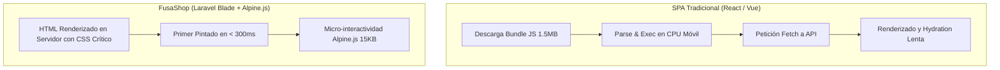

## 1. Stack Tecnológico Principal

FusaShop está construido sobre un stack moderno, pragmático y de alto rendimiento adaptado a las condiciones de conectividad de la provincia del Sumapaz:

| Componente | Tecnología | Versión | Justificación Técnica |
|---|---|---|---|
| **Backend Framework** | Laravel | 12.x | ORM expresivo (Eloquent), pipeline de eventos/colas, seguridad integrada y tipado estricto. |
| **Runtime** | PHP | 8.2+ / 8.3 | JIT compiler, tipos de unión, propiedades readonly, rendimiento de memoria superior. |
| **Base de Datos** | MariaDB / MySQL | 10.6+ / 8.0 | Motor InnoDB con soporte de transacciones ACID, bloqueos pesimistas (`FOR UPDATE`) e índices JSON. |
| **Frontend Reactivo** | Alpine.js | 3.x | Reactividad declarativa ultraligera (15 KB gzipped) integrada en Blade sin sobrecarga de hydration. |
| **Diseño y Estilos** | Tailwind CSS | v4.0 | Motor Oxygen sin archivos de configuración pesados, compilación JIT instantánea y CSS moderno. |
| **Colas y Asincronía** | Database Queue / Redis | Nativo | Desacople de procesos externos (Envía, Factus, Mail) para mantener tiempos de respuesta < 200 ms. |
| **Caché en Memoria** | File / Redis Cache | Nativo | Caché de tokens OAuth2 de Factus (50 min), catálogo y sesiones. |

---

## 2. ¿Por qué Arquitectura Server-Rendered (SSR) con Blade + Alpine en lugar de SPA?

En el contexto regional de Fusagasugá y sus veredas aledañas, muchos usuarios acceden a través de dispositivos móviles de gama media o redes celulares con latencia variable:

### Ventajas de esta decisión:
1. **First Contentful Paint (FCP) Inmediato:** El usuario visualiza la tienda y los productos en menos de 400 milisegundos, incluso en redes 3G o 4G inestables.
2. **SEO Nativo y OpenGraph:** Indexación directa en motores de búsqueda (Google) y vistas previas enriquecidas al compartir enlaces en WhatsApp o redes sociales sin servidores SSR adicionales.
3. **Simplicidad de Mantenimiento:** Un único repositorio sin duplicidad de modelos o validaciones entre cliente y servidor.
