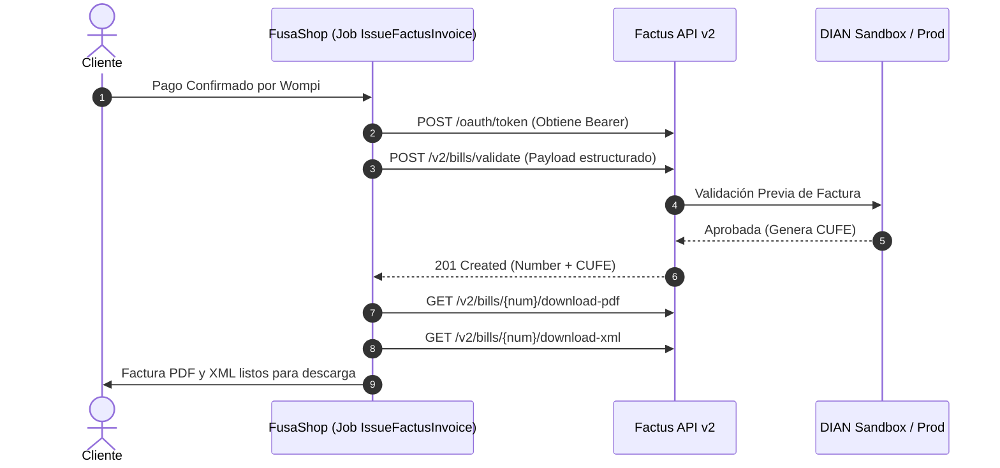

## 1. Wompi (Pasarela de Pagos Multitienda)

`WompiService` gestiona el ciclo transaccional con Bancolombia:

- **Firma de Integridad (SHA-256):**
  ```php
  public function integritySignature(string $reference, int $amountInCents, string $currency): string
  {
      return hash('sha256', $reference . $amountInCents . $currency . config('services.wompi.integrity_secret'));
  }
  ```
- **Validación de Webhooks:** El webhook `/api/webhooks/wompi` valida la firma del evento (`transaction.id + transaction.status + transaction.amount_in_cents + timestamp + events_secret`) antes de procesar cualquier cambio de estado.
- **Idempotencia:** Si Wompi reenvía el mismo evento aprobado múltiples veces, el sistema verifica `payment_status === 'paid'` para no duplicar descuentos de inventario ni envíos de facturas.

---

## 2. Envía Colvanes (Logística Nacional y Guías)

`EnviaService` implementa:
- **Cálculo de Volumen Cúbico:** Consolida múltiples productos en un único paquete equivalente para cotización precisa.
- **Job Asíncrono `GenerateEnviaShipment`:** Una vez confirmado el pago, el job solicita a Envía la creación del envío y persiste la URL del rótulo adhesivo y el número de seguimiento sin demorar la respuesta al usuario.

---

## 3. Factus (Facturación Electrónica DIAN - API v2)

FusaShop opera con la **versión 2 de la API de Factus**, garantizando cumplimiento estricto con los requisitos de la Dirección de Impuestos y Aduanas Nacionales (DIAN) de Colombia:



### Especificaciones de Integración con Factus v2

1. **Autenticación con Token Bearer:** Se almacena en caché por 50 minutos con auto-renovación si la API responde con 401.
2. **Estructura del Payload v2 (`POST /v2/bills/validate`):**
   - **`numbering_range_id`:** Rango activo otorgado por la DIAN (en sandbox: `389`, prefijo `SETP`).
   - **`payment_details`:** Arreglo con método de pago (`48` Tarjeta, `10` Efectivo, `42` Transferencia) y monto exacto.
   - **`customer`:** Códigos DIAN (`13` para Cédula, `31` para NIT con cálculo automático de Dígito de Verificación), y código DIVIPOLA de municipio (`25290` para Fusagasugá).
   - **`items`:** Precio unitario base antes de impuestos y desglose en arreglo `taxes` (`code: '01'`, `rate: '19.00'`).
   - **Unidad de Medida:** Código estándar DIAN `94` (Unidad).
3. **Descarga de Documentos:**
   - PDF: `GET /v2/bills/:number/download-pdf` (decodificado desde `pdf_base_64_encoded`).
   - XML: `GET /v2/bills/:number/download-xml` (decodificado desde `xml_base_64_encoded`).
4. **Resiliencia SSL:** Soporte para omitir validación estricta de certificados en entornos locales Windows mediante `withoutVerifying()`.
