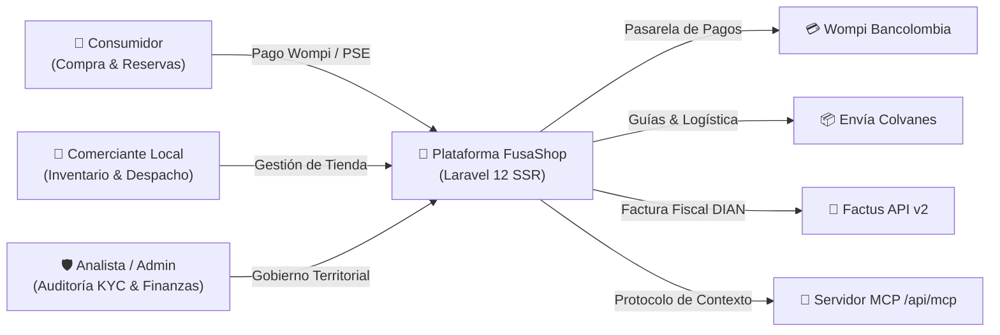

Bienvenido al centro oficial de documentación de **FusaShop**, la plataforma omnicanal de comercio territorial desarrollada en el marco del programa de Ingeniería de Sistemas de la **Universidad de Cundinamarca** para dinamizar el comercio formal y la economía productiva de **Fusagasugá y la Provincia del Sumapaz**.

<Card title="Ir al Portal Oficial de FusaShop" icon="arrow-up-right-from-square" href="https://fusashop.shop" color="#006C47">
  Explora la tienda en vivo, consulta comercios locales, catálogo de productos y servicios en **https://fusashop.shop**.
</Card>

---

## Asistente de Inteligencia Artificial (FusaBot IA)

<Tip>
  En cualquier página de esta documentación puedes interactuar con **FusaBot IA**, haciendo clic en el botón flotante **"Ayudante IA"** en la esquina inferior derecha o usando el atajo **Ctrl + K**. El asistente conoce a profundidad la totalidad de las especificaciones, código, flujos de usuario y arquitectura técnica de FusaShop.
</Tip>

---

## Los Tres Manuales Especializados

La documentación está organizada en tres manuales orientados a los distintos actores del ecosistema:

<CardGroup cols={3}>
  <Card title="Manual de Usuario" icon="users" href="/usuario" color="#006C47">
    Guías paso a paso para **Consumidores**, **Comerciantes** (onboarding KYC, catálogo y guías de despacho) y **Analistas/Administradores** institucionales.
  </Card>
  <Card title="Manual del Desarrollador" icon="code" href="/desarrollador" color="#10B981">
    Arquitectura Server-Rendered (SSR) con Laravel 12 + Alpine.js, servicios de dominio, integraciones (Wompi, Envía, Factus), servidor MCP y testing.
  </Card>
  <Card title="Manual Técnico" icon="server" href="/tecnico" color="#003545">
    Diccionario relacional de datos MariaDB, concurrencia atómica de inventario, máquinas de estados finitos, hardening de seguridad y despliegue en VPS.
  </Card>
</CardGroup>

---

## Flujo de Interacción Territorial

El siguiente diagrama resume cómo se articulan los actores de la plataforma con la infraestructura tecnológica:

