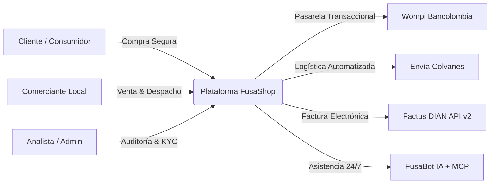

Bienvenido al centro oficial de documentación de **FusaShop**, la plataforma tecnológica de comercio electrónico y servicios O2O diseñada para la digitalización, formalización y dinamización comercial de Fusagasugá y la provincia del Sumapaz.

<Tip>
  Todos los manuales se encuentran sincronizados con la **rama final** de producción de FusaShop (v2.4-LTS), incluyendo pasarela multitienda Wompi, logística nacional con Envía, facturación electrónica DIAN con Factus API v2 y asistente virtual FusaBot con protocolo MCP.
</Tip>

## Descarga de Manuales Oficiales en PDF

Si necesitas los manuales en formato imprimible o para archivo institucional, puedes descargarlos de manera independiente a continuación:

<CardGroup cols={3}>
  <Card title="Manual de Usuario" icon="file-pdf" href="/pdfs/Manual_de_Usuario_FusaShop.pdf">
    Guía completa para Compradores, Comerciantes y Analistas. Flujos de compra, despacho, KYC y PQRS.
  </Card>
  <Card title="Manual del Desarrollador" icon="file-pdf" href="/pdfs/Manual_de_Desarrollador_FusaShop.pdf">
    Arquitectura Laravel 12 + Alpine.js, servicios de dominio, APIs externas, servidor MCP y 76 tests automatizados.
  </Card>
  <Card title="Manual Técnico" icon="file-pdf" href="/pdfs/Manual_Tecnico_FusaShop.pdf">
    Diccionario de base de datos, hardening de seguridad, mitigaciones OWASP, rendimiento WebP y despliegue en VPS.
  </Card>
</CardGroup>

---

## Estructura de la Documentación en Línea

Navega a través de los tres manuales utilizando las pestañas superiores o los enlaces directos a continuación:

<CardGroup cols={3}>
  <Card title="Manual de Usuario" icon="users" href="/usuario">
    Aprende a utilizar la plataforma según tu rol: Consumidor, Comerciante registrado o Analista operativo.
  </Card>
  <Card title="Manual del Desarrollador" icon="code" href="/desarrollador">
    Ecosistema tecnológico, convenciones de código, testing, jobs en segundo plano y cómo extender el sistema.
  </Card>
  <Card title="Manual Técnico" icon="server" href="/tecnico">
    Esquema relacional de base de datos, concurrencia atómica de inventario, crons de mantenimiento y servidores.
  </Card>
</CardGroup>

---

## Pilares Tecnológicos de FusaShop

