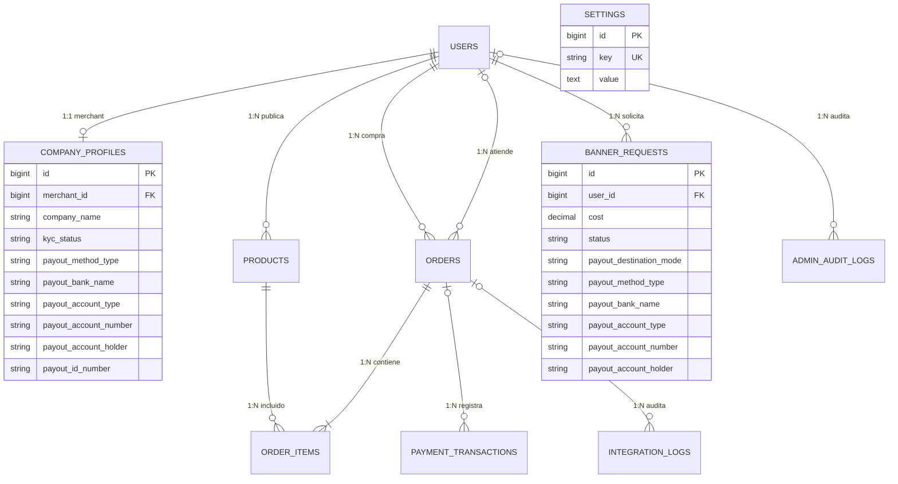

## 1. Diagrama Entidad-Relación Físico

---

## 2. Diccionario de Tablas Principales

### 2.1 Tabla `company_profiles` (Comercios y Cuentas de Pago)

| Campo | Tipo | Nulo | Descripción |
|---|---|---|---|
| `id` | `BIGINT UNSIGNED` | NO | Clave primaria autoincremental. |
| `merchant_id` | `BIGINT UNSIGNED` | NO | Clave foránea que referencia a `users.id` con eliminación en cascada. |
| `company_name` | `VARCHAR(255)` | NO | Razón social o nombre comercial de la tienda. |
| `kyc_status` | `ENUM` | NO | Estado de validación fiscal: `pending`, `approved`, `rejected`. |
| `payout_method_type` | `VARCHAR(30)` | SÍ | Modalidad de dispersión: `'bank'` (cuenta bancaria) o `'wallet'` (billetera digital). |
| `payout_bank_name` | `VARCHAR(100)` | SÍ | Nombre de la entidad bancaria o billetera digital. |
| `payout_account_type` | `VARCHAR(40)` | SÍ | Tipo de producto financiero: `'Ahorros'`, `'Corriente'`, `'Nequi'`, `'Daviplata'`. |
| `payout_account_number` | `VARCHAR(60)` | SÍ | Número de cuenta bancaria o número celular de 10 dígitos. |
| `payout_account_holder` | `VARCHAR(150)` | SÍ | Nombre o razón social del titular de la cuenta. |
| `payout_id_number` | `VARCHAR(40)` | SÍ | Cédula de Ciudadanía o NIT del titular para dispersión. |
| `wompi_integrity_secret` | `TEXT` | SÍ | Llave secreta de integridad de Wompi, cifrada con **AES-256-CBC**. |
| `wompi_events_secret` | `TEXT` | SÍ | Secreto para validación de webhooks, cifrado con **AES-256-CBC**. |

---

### 2.2 Tabla `orders` (Órdenes y Transacciones)

| Campo | Tipo | Nulo | Descripción |
|---|---|---|---|
| `id` | `BIGINT UNSIGNED` | NO | Identificador único de orden. |
| `user_id` | `BIGINT UNSIGNED` | NO | FK del comprador en `users.id`. |
| `merchant_id` | `BIGINT UNSIGNED` | SÍ | FK del comercio despachador en `users.id`. |
| `reference` | `VARCHAR(100)` | NO | Referencia única de pago (ej. `FS-8F3A29B...`). |
| `total` | `DECIMAL(12,2)` | NO | Monto total con flete e impuestos en pesos colombianos (COP). |
| `status` | `VARCHAR(30)` | NO | Etapa del pedido: `pending`, `processing`, `shipped`, `delivered`, `cancelled`. |
| `payment_status` | `VARCHAR(30)` | NO | Estado de pago: `pending`, `paid`, `failed`. |
| `shipping_carrier` | `VARCHAR(50)` | SÍ | Transportadora asignada (por defecto `'servientrega'` vía Envía). |
| `tracking_number` | `VARCHAR(100)` | SÍ | Número de guía logística expedido por Envía Colvanes. |
| `invoice_number` | `VARCHAR(50)` | SÍ | Número oficial de factura electrónica (ej. `SETP990028965`). |
| `invoice_cufe` | `VARCHAR(150)` | SÍ | Código Único de Factura Electrónica asignado por la DIAN. |

---

### 2.3 Tabla `banner_requests` (Publicidad y Dispersión)

| Campo | Tipo | Nulo | Descripción |
|---|---|---|---|
| `id` | `BIGINT UNSIGNED` | NO | Clave primaria. |
| `user_id` | `BIGINT UNSIGNED` | NO | FK del comerciante solicitante. |
| `cost` | `DECIMAL(10,2)` | NO | Valor pactado por el espacio publicitario. |
| `status` | `VARCHAR(30)` | NO | Estado: `pending`, `approved`, `rejected`. |
| `payout_destination_mode`| `VARCHAR(30)` | NO | Modo de cobro: `'corporate'` (FusaShop institucional) o `'custom'` (cuenta personalizada). |
| `payout_bank_name` | `VARCHAR(120)` | SÍ | Entidad bancaria receptora del ingreso de pauta. |
| `payout_account_type` | `VARCHAR(50)` | SÍ | Tipo de cuenta para dispersión de pauta. |
| `payout_account_number` | `VARCHAR(60)` | SÍ | Número de cuenta o billetera receptora. |
| `payout_account_holder` | `VARCHAR(150)` | SÍ | Titular de la cuenta receptora. |

---

### 2.4 Tabla `settings` (Parámetros Globales del Sistema)

Almacena configuraciones dinámicas institucionales, incluyendo el registro `banner_payout_config` que define los datos bancarios corporativos globales de FusaShop S.A.S. en formato JSON estructurado.
