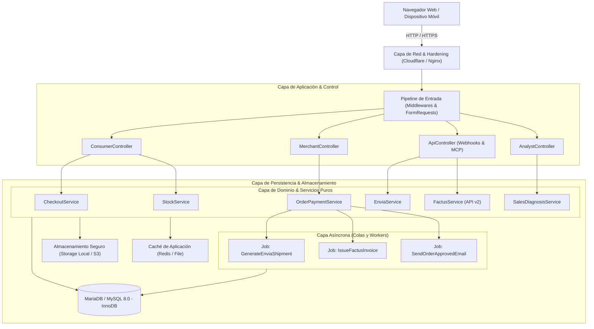

## 1. Arquitectura Multicapa del Sistema

FusaShop implementa una arquitectura multicapa desacoplada que separa claramente la presentación, la lógica del dominio y la persistencia de datos:

---

## 2. Principios de Diseño Aplicados

- **Separación de Responsabilidades (SoR):** Los controladores únicamente coordinan la entrada HTTP y delegan el procesamiento a clases de servicio especializadas.
- **Transaccionalidad Fuerte (ACID):** Toda operación que involucre inventario, pagos o estados de órdenes se ejecuta dentro de bloques `DB::transaction()`.
- **Desacople Orientado a Eventos:** Las operaciones lentas (emisión ante la DIAN, generación de etiquetas PDF de transporte, envío de correos electrónicos) se delegan a trabajadores en segundo plano gestionados por colas.
