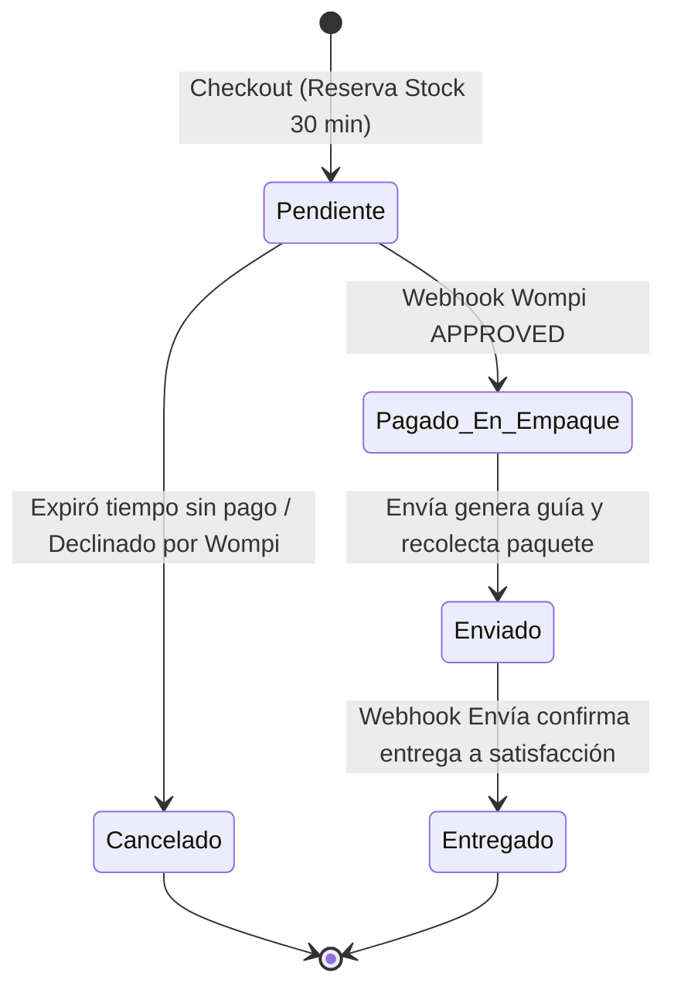

## 1. Ciclo de Vida de una Orden de Compra

El flujo de una orden en FusaShop se rige por una máquina de estados determinista con transiciones estrictas:



### Reglas de Transición:
1. **`pending` (Pendiente):** La orden ha sido creada y el inventario físico ha sido reservado mediante `reserved_stock`. Si transcurren 30 minutos sin confirmación de pago, el comando programado libera el inventario y pasa el estado a `cancelled`.
2. **`processing` (Pagado / En empaque):** El webhook de Wompi valida la firma SHA-256 y confirma la transacción. Se ejecuta `StockService::commit` descontando definitivamente las existencias físicas. Se disparan en paralelo los jobs asíncronos para generar la guía de Envía y emitir la factura DIAN.
3. **`shipped` (Enviado):** El comerciante imprime el rótulo adhesivo y entrega el paquete a Envía Colvanes.
4. **`delivered` (Entregado):** Envía notifica la entrega física exitosa. El saldo queda disponible para dispersión en el siguiente corte semanal.

---

## 2. Idempotencia en Pasarelas y Webhooks

Dado que los proveedores de pasarelas como Wompi reintentan los webhooks hasta por 24 horas en caso de respuestas lentas, FusaShop implementa un control de idempotencia estricto:

```php
// Verificación de idempotencia en OrderPaymentService
if ($order->payment_status === 'paid') {
    // El evento ya fue procesado con éxito; retornamos HTTP 200 sin duplicar jobs
    return response()->json(['status' => 'already_processed']);
}
```

Esto garantiza que una orden nunca sufra duplicidad de cobro, doble descuento de inventario ni facturación repetida ante la DIAN.
