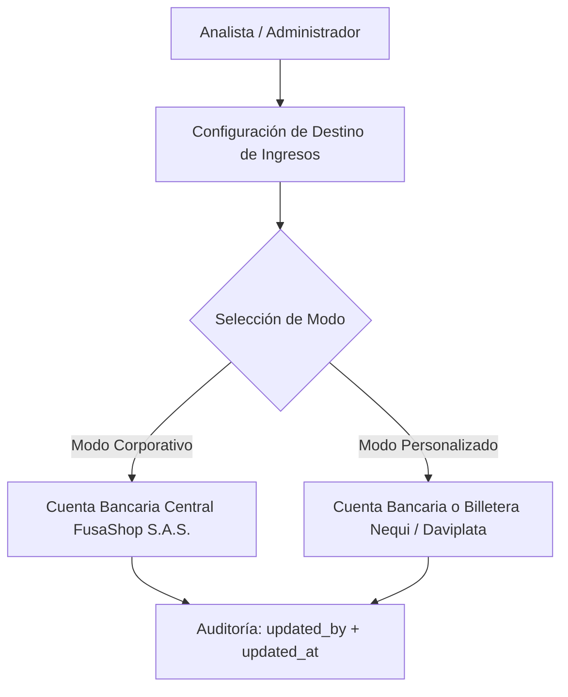

## 1. Panel Ejecutivo y Métricas Territoriales

Los analistas y administradores acceden al panel de control central para supervisar el rendimiento del ecosistema comercial de la región:

- **Indicadores Clave (KPIs):** Volumen Bruto de Mercancías (**GMV**), total de órdenes completadas, ticket promedio de compra y tasa de conversión.
- **Distribución por Municipios:** Análisis geográfico de compras y ventas entre Fusagasugá y los municipios aledaños del Sumapaz.
- **Diagnóstico Causal de Ventas:** Algoritmo que detecta automáticamente caídas de ventas, comerciantes rezagados o productos sin rotación para sugerir campañas de reactivación.

---

## 2. Gestión de Usuarios y Validación KYC

El analista actúa como garante legal de la plataforma:

1. **Bandeja de Comercios Pendientes:** Listado de tiendas que han subido su documentación fiscal.
2. **Visor de Documentos Seguro:** Inspección directa del RUT y Cámara de Comercio en PDF sin salir de la plataforma.
3. **Dictamen de Aprobación o Rechazo:**
   - **Aprobado:** Activa la tienda inmediatamente en el catálogo público y habilita la recepción de pagos.
   - **Rechazado:** Envía un correo automático al comerciante especificando la causal (ej. *"RUT borroso"*, *"Actividad económica no concordante"*).

---

## 3. Configuración de Destino de Ingresos por Banners

Desde la sección **Banners Publicitarios**, los analistas configuran a qué cuenta se dirigen los fondos pagados por los comerciantes por concepto de pauta publicitaria:

<Tabs>
  <Tab title="Modo Corporativo (Por Defecto)">
    * **Entidad Bancaria:** Banco institucional central de FusaShop.
    * **Tipo de Cuenta:** Cuenta Corriente o Ahorros empresarial.
    * **Número de Cuenta:** Número de cuenta bancaria corporativa.
    * **Titular Legal:** Razón social oficial (*"FusaShop S.A.S."*).
    * **NIT Institucional:** NIT con dígito de verificación.
  </Tab>
  <Tab title="Modo Personalizado (Cuentas Alternas / Billeteras)">
    * **Tipo de Método:** Cuenta Bancaria o Billetera Digital.
    * **Billeteras Digitales:** Soporte para **Nequi** o **Daviplata** con número celular de 10 dígitos.
    * **Titular y Documento:** Documentación del receptor designado.
  </Tab>
</Tabs>

Cada modificación queda grabada con marca temporal y nombre del analista responsable para evitar cambios no autorizados.

---

## 4. Auditoría de Integraciones y Monitoreo de APIs

La vista de **Integraciones** permite auditar en tiempo real la salud de las conexiones externas:

- **Wompi:** Registro de eventos de webhook, transacciones aprobadas, declinadas y validación de sumas de chequeo SHA-256.
- **Envía Colvanes:** Peticiones de cotización de fletes, generación de guías y webhooks de entrega.
- **Factus API v2:** Emisiones de facturas electrónicas, validaciones de la DIAN, generación de CUFE y descargas de PDF/XML.
- **Botón de Reintento Manual:** Si una API de terceros sufre una caída transitoria, el analista puede reintentar la tarea con un solo clic.

---

## 5. Bitácora Inmutable de Auditoría (`AdminAuditLog`)

Toda acción crítica realizada por cualquier analista o superadministrador (bloqueo de usuarios, cambios de comisiones, modificación de cuentas bancarias, exportación de reportes) se persiste en una tabla de auditoría inmutable que registra:
- ID del administrador responsable.
- Dirección IP de origen y agente de usuario (navegador).
- Acción ejecutada y datos antes/después en formato JSON.
