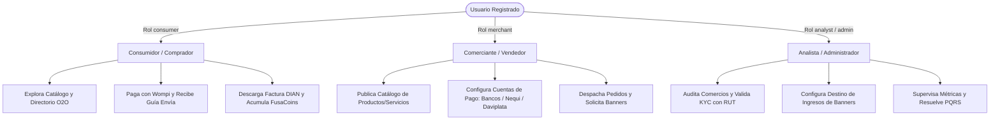

## 1. Introducción y Propósito Regional

**FusaShop** nace como una solución de comercio electrónico multitienda y omnicanal orientada a resolver las barreras tradicionales de digitalización de las micro, pequeñas y medianas empresas (MiPyMEs) de **Fusagasugá y la Provincia del Sumapaz** (Silvania, Arbeláez, Pasca, San Bernardo, Pandi, Tibacuy, Cabrera, Granada, Venecia).

La plataforma no es simplemente una tienda virtual: es una **infraestructura territorial** que conecta el comercio formal local con consumidores digitales, articulando en un único flujo de compra:
- Pasarela de pago segura multitienda (**Wompi Bancolombia**).
- Liquidación y generación de guías logísticas con cobertura nacional (**Envía Colvanes**).
- Emisión automática de facturación electrónica validada ante la DIAN (**Factus API v2**).
- Asistencia virtual inteligente basada en IA y protocolo de contexto (**FusaBot + MCP**).

---

## 2. Los Tres Roles de la Plataforma

<CardGroup cols={3}>
  <Card title="Consumidor" icon="bag-shopping" href="/usuario/consumidor">
    Compradores residenciales o corporativos que acceden a productos físicos y servicios locales con entrega a domicilio o reserva presencial.
  </Card>
  <Card title="Comerciante" icon="store" href="/usuario/comerciante">
    Empresas, tiendas, artesanos y prestadores de servicios que gestionan inventario, precios, despachos y reciben pagos directos.
  </Card>
  <Card title="Analista / Admin" icon="shield-halved" href="/usuario/analista">
    Equipo operativo institucional que audita el ecosistema, valida documentos fiscales (KYC), supervisa transacciones y administra la plataforma.
  </Card>
</CardGroup>
